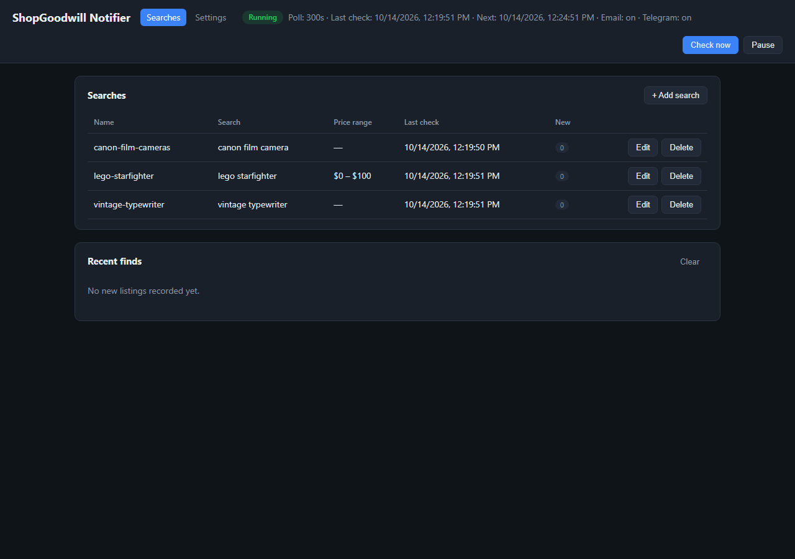
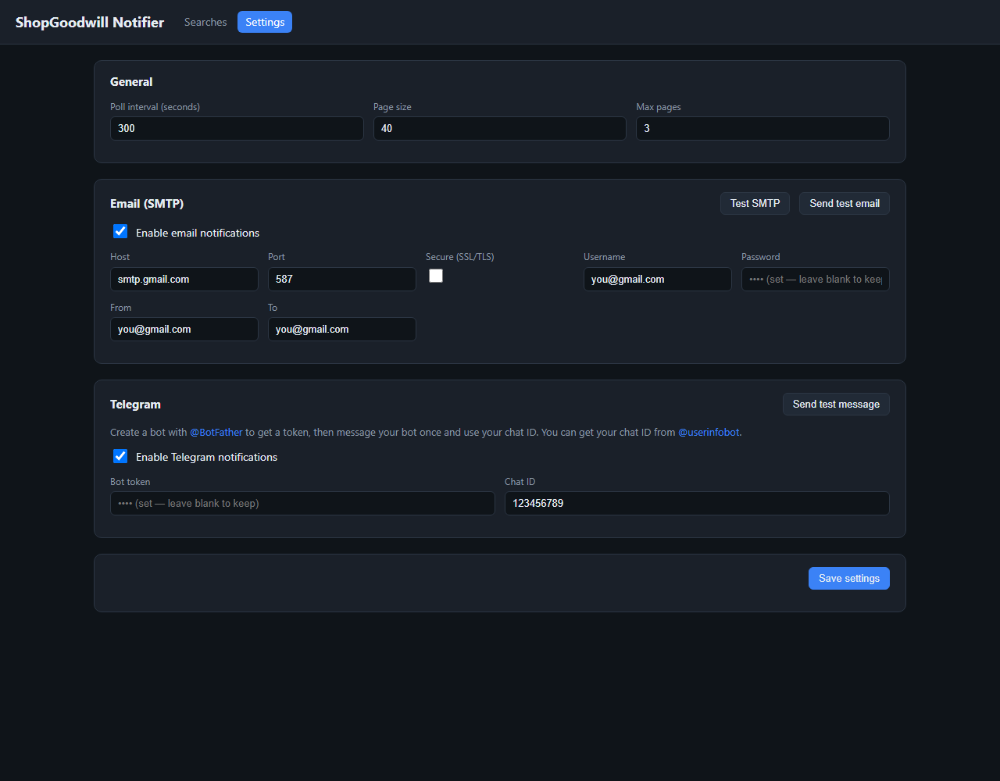

# ShopGoodwill Notifier

Polls the [ShopGoodwill.com](https://shopgoodwill.com) search API and notifies
you when it finds new listings matching your search terms. Includes a **web
console** for managing searches, settings, and reviewing finds.

## What's New

- **v1.0.0** — First release. Adds the web console (Searches + Settings pages),
  **Telegram** notifications alongside email, and per-channel enable/disable
  toggles. See the [changelog](CHANGELOG.md) for details.

## Screenshots

| Searches | Settings |
| --- | --- |
|  |  |

## Features

- Monitors multiple search queries against ShopGoodwill's buyer API
  (`POST https://buyerapi.shopgoodwill.com/api/Search/ItemListing`).
- Tracks every listing ID it has already seen, so only *new* listings trigger
  a notification. The first run records a baseline and does not notify.
- Sends alerts via **email** (SMTP), **Telegram**, and/or **ntfy** push
  notifications.
- Web console with two pages: **Searches** (add/edit/delete searches, review
  finds, run manual checks, pause/resume) and **Settings** (polling, email,
  Telegram, ntfy).

## Setup

```sh
npm install
cp config.example.json config.json
cp .env.example .env
```

Edit `config.json` with your search terms and SMTP settings (or do both from
the web console after starting). For Gmail, use an
[App Password](https://support.google.com/accounts/answer/185833).

## Run

### Web console (default)

```sh
npm run dev     # development, auto-reload (tsx watch)
npm start       # after `npm run build`
```

Then open <http://localhost:7823>. The monitor starts polling in the
background automatically.

### Command line

```sh
npm run once    # run a single check and exit (useful for cron)
npm run cli     # run the monitor loop in the terminal (no web UI)
```

Both accept `--config /path/to/config.json` to use a different config file.

## Configuration

`config.json`:

| Key                   | Description                                        | Default |
| --------------------- | -------------------------------------------------- | ------- |
| `pollIntervalSeconds` | Seconds between polls in monitor mode              | `300`   |
| `pageSize`            | Results per page                                   | `40`    |
| `maxPages`            | Max pages to fetch per query                       | `3`     |
| `seenFile`            | Seen-listing state file                            | `data/seen_listings.json` |
| `historyFile`         | Record of new listings found                       | `data/history.json` |
| `smtp`                | Email settings (see below)                         | `{}`    |
| `telegram`            | Telegram settings (see below)                      | `{}`    |
| `ntfy`                | ntfy push settings (see below)                     | `{}`    |
| `queries`             | Array of search queries (see below)                | —       |

`smtp` (also settable via `.env` as a fallback):

| Key       | Description                    |
| --------- | ------------------------------ |
| `enabled` | `false` to turn off email alerts while keeping settings |
| `host`    | SMTP host (e.g. `smtp.gmail.com`) |
| `port`    | SMTP port (e.g. `587`)         |
| `secure`  | `true` for SSL/TLS             |
| `user`    | SMTP username                  |
| `pass`    | SMTP password / app password   |
| `from`    | Sender address                 |
| `to`      | Recipient address              |

`telegram` (also settable via `.env` as a fallback):

| Key        | Description                                        |
| ---------- | -------------------------------------------------- |
| `enabled`  | `false` to turn off Telegram alerts while keeping settings |
| `botToken` | Bot token from [@BotFather](https://t.me/BotFather) |
| `chatId`   | Chat to send to (get yours from [@userinfobot](https://t.me/userinfobot)) |

`ntfy` (also settable via `.env` as a fallback):

| Key       | Description                                          |
| --------- | ---------------------------------------------------- |
| `enabled` | `false` to turn off ntfy alerts while keeping settings |
| `server`  | ntfy server URL (defaults to `https://ntfy.sh`)      |
| `topic`   | Topic to publish to (subscribe to it in the ntfy app) |
| `token`   | Optional access token for protected topics/servers   |

Each `query` supports:

| Key                         | Description                                    |
| --------------------------- | ---------------------------------------------- |
| `name`                      | Unique name (used for the seen-state key)      |
| `searchText`                | Search keywords                                |
| `lowPrice` / `highPrice`    | Price range filters                            |
| `selectedCategoryIds`       | Comma-separated category IDs                   |
| `selectedSellerIds`         | Comma-separated seller IDs                     |
| `searchBuyNowOnly`          | Buy-it-now listings only                       |
| `searchPickupOnly`          | Pickup-only listings only                      |
| `searchOneCentShippingOnly` | $0.01 shipping only                            |
| `searchDescriptions`        | Also search item descriptions                  |
| `searchCanadaShipping`      | Include items that ship to Canada              |
| `searchUSOnlyShipping`      | US-shipping-only listings                      |
| `searchInternationalShippingOnly` | International shipping only              |
| `maxPages`                  | Override `maxPages` for this query             |

## Docker / Synology NAS

A `Dockerfile` and `docker-compose.yml` are included so you can run this on a
Synology NAS (or any Docker host) with the web console always available.

### 1. Prepare a project folder on the NAS

Create a folder, e.g. `/volume1/docker/shopgoodwill-notifier`, and place in it:

- `docker-compose.yml` (from this repo)
- `config.json` — copy `config.example.json` and edit your queries + SMTP
- an empty `data` folder (for seen-listings/history state)

> Note: make sure `smtp.to` is a *different* address than `smtp.from`, otherwise
> Gmail files your alerts under Sent/All Mail instead of the Inbox. A `+` alias
> like `you+sgw@gmail.com` delivers to the same inbox and works around this.

### 2. Start it with Container Manager

1. Open **Container Manager** → **Project** → **Add**.
2. Set the path to the project folder above and the compose file source to
   `docker-compose.yml` (or "Create docker-compose.yml").
3. Build & start. The console will be at `http://<NAS-IP>:7823`.

### 3. Or via SSH

```sh
cd /volume1/docker/shopgoodwill-notifier
docker compose up -d --build
```

### Notes

- `config.json` and `data/` are bind-mounted, so your settings and seen-state
  survive container rebuilds/updates.
- The image is multi-arch (`node:22-alpine`); build on the NAS itself so it
  matches your NAS architecture (x86_64 or ARM64).
- Port and timezone are configurable in `docker-compose.yml` (`PORT`, `TZ`).

## Publish to GHCR and deploy with Portainer

A GitHub Actions workflow (`.github/workflows/docker-publish.yml`) builds a
multi-arch image (`linux/amd64` + `linux/arm64`) and pushes it to
**ghcr.io** on every push to `main`, on `v*` tags, or manually.

### Publishing

1. Create a GitHub repo and push this project (default branch `main`):

   ```sh
   git init && git add . && git commit -m "Initial commit"
   git remote add origin https://github.com/OWNER/REPO.git
   git push -u origin main
   ```

2. GitHub Actions will build and push automatically. The image is
   `ghcr.io/OWNER/REPO:latest` (plus `:main` and `:vX.Y.Z` tags).

### Deploy in Portainer

1. On the NAS, create a folder (e.g. `/volume1/docker/shopgoodwill-notifier`),
   and inside it:
   - a file `config.json` containing `{}` (empty config — you'll configure the
     rest in the console), or your full config copied from `config.example.json`
   - an empty `data` folder
   > Docker auto-creates directories but **not** files, so `config.json` must
   > already exist or the bind mount fails.
2. In Portainer, add your GitHub container registry
   (**Registries** → `ghcr.io`, username = your GitHub username, password = a
   GitHub Personal Access Token with `read:packages`). Skip this if the image is
   public.
3. **Stacks** → **Add stack**, and paste the contents of
   `docker-compose.ghcr.yml` (edit `OWNER/REPO` and the volume path). Deploy.
4. Console: `http://<NAS-IP>:7823`. Add your searches and SMTP there; they are
   written to the mounted `config.json` and persist across updates.

### Secrets stay local

Your login info is **never** committed to GitHub or baked into the image:

- `config.json` (SMTP app password) and `.env` are in `.gitignore` and
  `.dockerignore`, so they are excluded from both the repo and the Docker build
  context.
- The image ships only `config.docker.json`, which contains placeholder values
  and no credentials.
- At runtime, Portainer mounts **your** `config.json` as a volume on the NAS.
  Credentials live only in that local file, never in the image or on GitHub.
- `.env.example` and `config.example.json` contain only placeholders and are
  safe to commit.

## Deploying as a background task

The web console runs in the foreground. Run it under a process manager
(systemd, PM2, Windows Task Scheduler, etc.), or schedule `npm run once` with
cron/Task Scheduler for a check-only workflow.

## Notes

- ShopGoodwill's API is not public/documented and may change without notice.
- Be respectful: keep `pollIntervalSeconds` reasonable (e.g. >= 300s).
